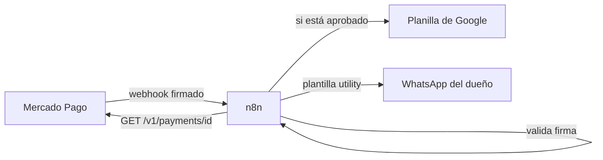

# Aviso de pagos: Mercado Pago → planilla + WhatsApp

> Cada vez que un cliente te paga por Mercado Pago, el pago queda anotado en una planilla de Google y te llega un WhatsApp con el monto, quién pagó y por qué. Sin entrar a la app ni copiar datos a mano.

<!-- Demo: agregar docs/demo.gif (WhatsApp recibiendo el aviso + planilla llenándose) y descomentar:

-->

## El problema

Un comercio chico que cobra con links de pago, QR o transferencias de Mercado Pago:

- revisa la app varias veces al día para saber si "ya pagó",
- copia los pagos a mano en una planilla para el cierre de caja o para el contador,
- se le pasan pagos o los anota dos veces.

## La solución



1. Mercado Pago avisa al webhook cada vez que hay un pago.
2. n8n **valida la firma** (`x-signature`), así nadie puede mandar pagos falsos.
3. Consulta el pago en la API de Mercado Pago, porque la notificación trae solo el id.
4. Si el pago está `approved`, descarta duplicados (Mercado Pago puede notificar más de una vez), lo registra en la planilla y manda el WhatsApp.

## Stack

| Pieza | Uso |
|---|---|
| n8n (self-hosted) | Orquestación del flujo |
| PostgreSQL | Base de datos de n8n |
| Caddy | HTTPS automático (Mercado Pago y Meta exigen HTTPS) |
| Mercado Pago API | Webhooks + consulta de pagos |
| WhatsApp Cloud API (Meta, oficial) | Aviso por plantilla |
| Google Sheets | Registro de pagos |

## Cómo levantarlo

### 1. Servidor
Un VPS con Docker (probado pensando en un Contabo Cloud VPS 10 con Ubuntu 24.04) y un dominio o subdominio con un registro **A** apuntando a la IP del VPS.

```bash
git clone https://github.com/<tu-usuario>/pagos-mp-whatsapp.git
cd pagos-mp-whatsapp
cp .env.example .env   # completar
docker compose up -d
```

Abrí `https://TU_DOMINIO` y creá el usuario dueño de n8n.

### 2. Importar el flujo
En n8n: **Workflows → Import from file** → `workflows/pago-mp-a-whatsapp.json`.
Después, en el nodo **Registrar en planilla**, elegí tu credencial de Google (OAuth2).

### 3. Planilla
Creá una planilla con una hoja llamada `Pagos` y esta fila de encabezados:

```
id_pago | fecha | monto | monto_texto | medio | pagador | descripcion | referencia
```

### 4. Mercado Pago
1. En [Tus integraciones](https://www.mercadopago.com.ar/developers/panel/app) creá una aplicación.
2. Copiá el **Access Token de prueba** a `MP_ACCESS_TOKEN`.
3. En **Webhooks**, configurá la URL `https://TU_DOMINIO/webhook/mercadopago`, marcá el evento **Pagos** y copiá la **clave secreta** a `MP_WEBHOOK_SECRET`.

### 5. WhatsApp
1. En [Meta for Developers](https://developers.facebook.com/) creá una app de tipo *Business* y agregá el producto **WhatsApp**.
2. Para probar, Meta te da un **número de prueba gratis** que puede mandar mensajes a hasta 5 números que verifiques.
3. Creá y mandá a aprobar una plantilla de categoría **Utility** llamada `aviso_pago_recibido`, idioma `es_AR`:

   > Nuevo pago recibido: {{1}} de {{2}} por {{3}}. Ya quedó registrado en tu planilla.

4. Completá `WA_TOKEN`, `WA_PHONE_NUMBER_ID` y `DUENO_WHATSAPP` en el `.env` y reiniciá: `docker compose up -d`.

> ¿Por qué una plantilla y no un mensaje común? WhatsApp solo deja mandar texto libre dentro de las 24 h posteriores a que la persona te escribió. Un aviso que inicia el negocio tiene que ser una plantilla aprobada.

### 6. Probar
- Activá el flujo, hacé un pago con una [cuenta de prueba](https://www.mercadopago.com.ar/developers/es/docs/your-integrations/test/accounts) y mirá **Executions** en n8n.
- O simulá la notificación con un id de pago de prueba:

```bash
node scripts/simular-notificacion.mjs https://TU_DOMINIO/webhook/mercadopago <id-de-pago> <clave-secreta>
```

## Seguridad
- La firma de cada notificación se verifica con HMAC-SHA256 y comparación en tiempo constante.
- Los tokens viven en `.env` (fuera del repo) y n8n no expone puertos: solo Caddy publica 80/443.
- En producción, el token de WhatsApp es el de un *System User* del portfolio comercial **del cliente**, no un token personal.

## Costos de operación (referencia, noviembre 2026)
| Concepto | Costo aprox. |
|---|---|
| VPS Contabo Cloud VPS 10 (compartido entre varios clientes) | ~€4,50/mes |
| Mensaje utility de WhatsApp a un número argentino | ~USD 0,026 por mensaje |
| n8n self-hosted, Google Sheets y webhooks de Mercado Pago | sin costo |

Un negocio con 300 pagos por mes gasta cerca de USD 8 en WhatsApp. Las tarifas de Meta cambian: revisá la [tabla oficial](https://developers.facebook.com/docs/whatsapp/pricing).

## Ideas para seguir
- Resumen diario de ventas a las 21 h (nodo Schedule).
- Aviso al cliente que pagó, con el comprobante.
- Reembolsos y contracargos a un canal aparte.

---
Hecho por [Dimas Alexis Zabala](https://portafolio-olive-nine-45.vercel.app/) · Automatizaciones e integraciones · Santa Rosa, La Pampa.
